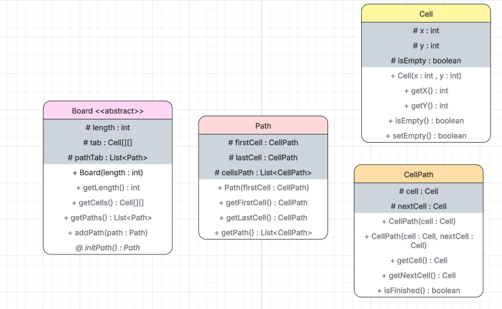
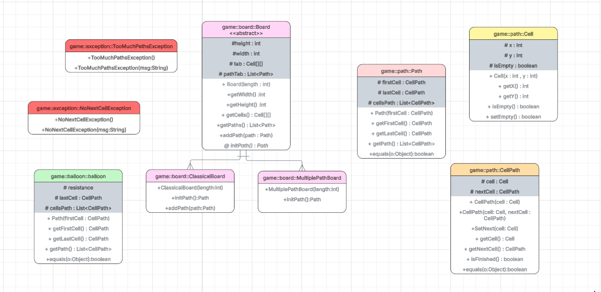

# l2s4-projet-2026

# Equipe

- Yanis GANNAR
- Jean-Mayes ZITOUNI
- Noe CARPENTIER
- Merwan SERGENT

# Sujet

[Le sujet 2026](https://www.fil.univ-lille.fr/~varre/portail/l2s4-projet/sujet2026.pdf)

# Livrables

Les paragraphes concernant les livrables doivent être remplis avant la date de rendu du livrable. A chaque fois on décrira l'état du projet par rapport aux objectifs du livrable. Il est attendu un texte de plusieurs lignes qui explique la modélisation choisie, et/ou les algorithmes choisis et/ou les modifications apportées à la modélisation du livrable précédent.

Un lien vers une image de l'UML doit être fourni (une photo d'un diagramme UML fait à la main est suffisant).

## Livrable 1

### Atteinte des objectifs

### Difficultés restant à résoudre

## Livrable 2

### Atteinte des objectifs

### Difficultés restant à résoudre

## Livrable 3

### Atteinte des objectifs

### Difficultés restant à résoudre

## Livrable 4

### Atteinte des objectifs

### Difficultés restant à résoudre

## Livrable 5

### Atteinte des objectifs

### Difficultés restant à résoudre

## Livrable 6

### Atteinte des objectifs

### Difficultés restant à résoudre

# Journal de bord

Le journal de bord doit être rempli à la fin de chaque séance encadrée, et **avant** de quitter la salle.

Pour chaque semaine on y trouvera :

- ce qui a été réalisé, les difficultés rencontrées et comment elles ont été surmontées (on attend du contenu, pas uniquement une phrase du type "tous les objectifs ont été atteints")
- la liste des objectifs à réaliser d'ici à la prochaine séance encadrée

## Semaine 1

### Ce qui a été réalisé
Pour commencer, on a essayé de mieux comprendre le jeu en y jouant, puis on a commencé le diagramme UML, on s'est concentré sur le plateau et la gestion des cellules et chemins.
### Difficultés rencontrées
savoir comment modéliser un chemin, et savoir quel méthode mettre dans le plateau notamment pour savoir comment accéder à la cell suivante. C'est pourquoi nous avons décidé d'y remédier avec classe "CellPath".
### Objectifs pour la semaine et répartition du travail par membre
Finir le diagramme pour les plateaux différents. Pour cette semaine, aucune répartion car nous allons le faire en groupe pour aligner nos idées, nous allons notamment écrire les sous-classes de board.

## Semaine 2

### Ce qui a été réalisé
Pour commencer nous avons modifier l'UML afin d'obtenir notre version potentiellement finale de la partie Board(les chemins,les cellules et le board en lui même ainsi que ces exceptions). Nous avons notamment terminer les sous classes de Board, 2 sous classes différente en fonction du type de plateau. Ensuite nous avons commencer a coder en se repartissant les classes.

### Difficultés rencontrées
La création des chemins notamment la méthode initPath de la classe classicalBoard (nous n'avons pas encore commencé MultipleBoard), pour l'instant on a une idée de comment faire que l'on essayera de finir dans la semaine.

### Objectifs pour la semaine et répartition du travail par membre
Chacun finis ses classes, documentation et tests compris :
Merwan : TooMuchPathsException, NoNextCellException, CellPath
Yanis : Board <<abstract>>
Jean-Mayes : Cell, Path
Noé : ClassicalBoard 
Pour ce qui est de MultipleBoard on essayera de refléchir ensemble en essayant de reprendre un petit peu le code de ClassicalBoard 

## Semaine 3

ne pas prendre en compte la classe balloon !!

### Ce qui a été réalisé : 
On a essayé de mettre en commun le projet chacun a merge sa partie, on a modifié les erreurs et les incohérences ce qui a entrainé des modifications de l'UML et des tests. Un affichage a été rajouté dans la classe classicalBoard. La classe MultipleBoard est finis mais pas encore testé.

### Difficultés rencontrées
La majorité des difficultés rencontrés aujourd'hui etait dans la manipulation de gitlab et notamment des merges qui nous ont pris beaucoup de temps a regler (... commit behind). 

### Objectifs pour la semaine et répartition du travail par membre
Tout tester et tout compiler pour le livrable de cette semaine 
## Semaine 4

### Ce qui a été réalisé

### Difficultés rencontrées

### Objectifs pour la semaine et répartition du travail par membre

## Semaine 5

### Ce qui a été réalisé

### Difficultés rencontrées

### Objectifs pour la semaine et répartition du travail par membre

## Semaine 6

### Ce qui a été réalisé

### Difficultés rencontrées

### Objectifs pour la semaine et répartition du travail par membre

## Semaine 7

### Ce qui a été réalisé

### Difficultés rencontrées

### Objectifs pour la semaine et répartition du travail par membre

## Semaine 8

### Ce qui a été réalisé

### Difficultés rencontrées

### Objectifs pour la semaine et répartition du travail par membre

## Semaine 9

### Ce qui a été réalisé

### Difficultés rencontrées

### Objectifs pour la semaine et répartition du travail par membre

## Semaine 10

### Ce qui a été réalisé

### Difficultés rencontrées

### Objectifs pour la semaine et répartition du travail par membre

## Semaine 11

### Ce qui a été réalisé

### Difficultés rencontrées

### Objectifs pour la semaine et répartition du travail par membre

## Semaine 12

### Ce qui a été réalisé

### Difficultés rencontrées

### Objectifs pour finaliser le projet et répartition du travail par membre
