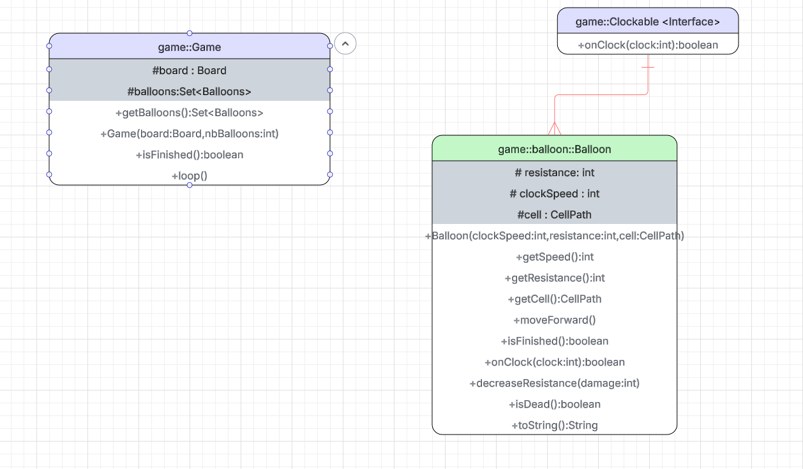
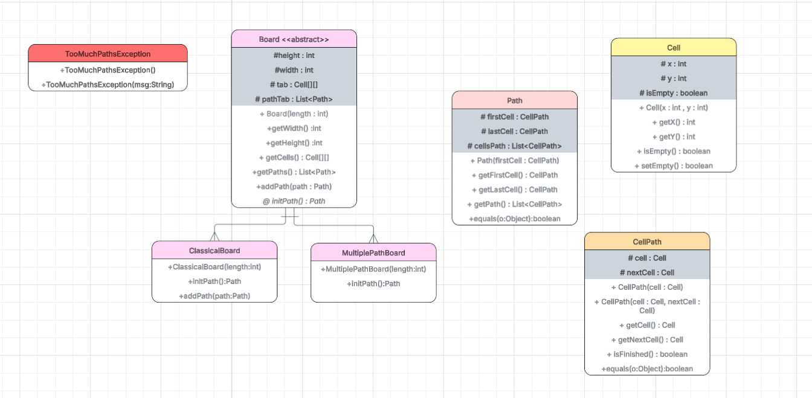

# l2s4-projet-2026

# Equipe

- Yanis GANNAR
- Jean-Mayes ZITOUNI
- Noe CARPENTIER
- Merwan SERGENT

# Sujet

[Le sujet 2026](https://www.fil.univ-lille.fr/~varre/portail/l2s4-projet/sujet2026.pdf)

# Livrables

Les paragraphes concernant les livrables doivent être remplis avant la date de rendu du livrable. A chaque fois on décrira l'état du projet par rapport aux objectifs du livrable. Il est attendu un texte de plusieurs lignes qui explique la modélisation choisie, et/ou les algorithmes choisis et/ou les modifications apportées à la modélisation du livrable précédent.

Un lien vers une image de l'UML doit être fourni (une photo d'un diagramme UML fait à la main est suffisant).

## Livrable 1
#### Voici les commandes de compilations :

```bash
javac -sourcepath src src/game/*.java -d classes
```

#### Les commandes de JavaDoc : 

```bash
javadoc -sourcepath src -subpackages game.path game.board -d docs
```

#### Compilation des tests :
```bash
javac -classpath junit-console.jar:classes tests/game/path/*.java && javac -classpath junit-console.jar:classes tests/game/*.java
```
#### Execution des tests : 
```bash
java -jar junit-console.jar -classpath tests:classes -scan-classpath
```
#### Création d'un jar : 
```bash
jar cvfe Livrable1aMain.jar game.Livrable1aMain -C classes game

jar cvfe Livrable1bMain.jar game.Livrable1bMain -C classes game
```
#### Execution des jar : 
```bash
java -jar Livrable1aMain.jar 50 10

java -jar Livrable1aMain.jar 50 10
```

### Atteinte des objectifs
Au cours de ces trois semaines, nous avons d’abord pris le temps de comprendre le fonctionnement du jeu en y jouant, ce qui nous a permis de déterminer comment représenter le plateau et ses éléments dans le code. Nous avons choisi de structurer le projet autour d’une classe abstraite Board, qui définit le comportement général d’un plateau, et de deux sous-classes, ClassicalBoard et MultipleBoard, représentant les différents types de plateau. Les cellules sont modélisées par la classe Cell et les chemins par CellPath, ce qui permet de gérer la navigation d’une cellule à l’autre et de traiter les exceptions spécifiques comme l’absence de cellule suivante ou la présence de trop de chemins. Ces choix ont été guidés par le besoin d’avoir une architecture claire et extensible tout en facilitant l’écriture des tests et de la documentation.

L’implémentation a avancé progressivement. Après avoir défini l’UML, nous avons commencé à coder chaque classe en répartissant le travail, puis nous avons mis en commun les différentes parties du projet. Des modifications ont été apportées pour corriger les incohérences et adapter le diagramme aux besoins réels du code. Aujourd’hui, les classes principales du plateau et des chemins sont fonctionnelles, les deux types de plateau sont implémentés, et les deux mains principales permettant de tester le programme sont opérationnelles. Le projet compile et s’exécute correctement, bien que certains tests et ajustements mineurs aient été nécessaires pour garantir la cohérence de l’ensemble.

Nous avons aussi reussi a nous adapter a la programmation en groupe et notre repartition du travail etait tres efficace et cohérente. 


ne pas prendre en compte la classe balloon !!

### Difficultés restant à résoudre
Nous esperons garder cette gestion pour le prochain livrable et même l'ameliorer car pour l'instant nous decouvrons encore nos outils tel que gitlab qui nous ont fait perdre beaucoup de temps.
Pour ce qui est de ce livrable il parait plutot complet des modifications futures ne sont pas a exclures mais nous ne faisons pas fasse a un probleme majeur qu'il nous reste a resoudre.
## Livrable 2

### Atteinte des objectifs
Au cours de cette semaine, nous avons à partir de notre UML décidé de certaines choses. Tout d'abord nous avons choisi ce moment pour implémenter la classe Game. Après analyse des objectifs à atteindre, c'est-à-dire, avoir des ballons qui avancent sur un chemin en fonction de leur vitesse de déplacement, nous avons décidé que la classe Game gérant le déroulement de la partie nous était nécessaire. De ce fait nous avons réussi à créer un système de clock qui nous permet et nous permettra par la suite d'effectuer différents actions en fonction du temps (temps de la partie, cooldown etc...).
Il nous restait donc à créer ces ballons qui devaient se déplacer. De ce fait nous avons tout naturellement créer une seule classe Ballon pour l'instant, car le déplacement s'effectue de la même manière sur les 2 plateaux différents. Grâce à notre implémentation du chemin, qui consiste à donner à chaque cellule du chemin, l'information sur la cellule suivante, la gestion des mouvements a été plutôt simple cette fois-ci.

Après mûre réflexion, nous nous somme rendus compte que les ballons ne seront pas les seules objets soumis a un timer. Nous avons donc décidé en prévision de créer l'interface qui sera implémentée par tous les objets qui ont besoin de la clock.

Comme d'habitude nous nous sommes répartis les tâches au maximum mais cette fois ci nous avons pris un peu de temps pour être sûr que tout le monde avait bien la même vision, car ceci nous avait causé défaut par le passé.
Les objectifs sont donc atteints pour cette semaine, nous avons des ballons qui se déplacent sur chaque chemin du plateau et globalement notre coordination en équipe s'est amélioré, nous avons eu moins d'erreur liés à une mauvaise compréhension de la vision commune.
Ce livrable n'est peut être pas complet mais il nous laisse facilement implémenter de nouvelles spécificités à nos fonctionnalités déjà implémentées.




### Difficultés restant à résoudre
Appliquer ce systeme de clock sur tout les autres objets qui ont une durée entre leurs différentes actions comme par exemples les tourelles etc. 


## Livrable 3

### Atteinte des objectifs

### Difficultés restant à résoudre

## Livrable 4

### Atteinte des objectifs

### Difficultés restant à résoudre

## Livrable 5

### Atteinte des objectifs

### Difficultés restant à résoudre

## Livrable 6

### Atteinte des objectifs

### Difficultés restant à résoudre

# Journal de bord

Le journal de bord doit être rempli à la fin de chaque séance encadrée, et **avant** de quitter la salle.

Pour chaque semaine on y trouvera :

- ce qui a été réalisé, les difficultés rencontrées et comment elles ont été surmontées (on attend du contenu, pas uniquement une phrase du type "tous les objectifs ont été atteints")
- la liste des objectifs à réaliser d'ici à la prochaine séance encadrée

## Semaine 1

### Ce qui a été réalisé
Pour commencer, on a essayé de mieux comprendre le jeu en y jouant, puis on a commencé le diagramme UML, on s'est concentré sur le plateau et la gestion des cellules et chemins.
### Difficultés rencontrées
savoir comment modéliser un chemin, et savoir quel méthode mettre dans le plateau notamment pour savoir comment accéder à la cell suivante. C'est pourquoi nous avons décidé d'y remédier avec classe "CellPath".
### Objectifs pour la semaine et répartition du travail par membre
Finir le diagramme pour les plateaux différents. Pour cette semaine, aucune répartion car nous allons le faire en groupe pour aligner nos idées, nous allons notamment écrire les sous-classes de board.


## Semaine 2

### Ce qui a été réalisé
Pour commencer nous avons modifier l'UML afin d'obtenir notre version potentiellement finale de la partie Board(les chemins,les cellules et le board en lui même ainsi que ces exceptions). Nous avons notamment terminer les sous classes de Board, 2 sous classes différente en fonction du type de plateau. Ensuite nous avons commencer a coder en se repartissant les classes.


### Difficultés rencontrées
La création des chemins notamment la méthode initPath de la classe classicalBoard (nous n'avons pas encore commencé MultipleBoard), pour l'instant on a une idée de comment faire que l'on essayera de finir dans la semaine.

### Objectifs pour la semaine et répartition du travail par membre
Chacun finis ses classes, documentation et tests compris :
Merwan : TooMuchPathsException, NoNextCellException, CellPath
Yanis : Board <<abstract>>
Jean-Mayes : Cell, Path
Noé : ClassicalBoard 
Pour ce qui est de MultipleBoard on essayera de refléchir ensemble en essayant de reprendre un petit peu le code de ClassicalBoard 

## Semaine 3


ne pas prendre en compte la classe balloon !!

### Ce qui a été réalisé : 
On a essayé de mettre en commun le projet chacun a merge sa partie, on a modifié les erreurs et les incohérences ce qui a entrainé des modifications de l'UML et des tests. Un affichage a été rajouté dans la classe classicalBoard. La classe MultipleBoard est finis mais pas encore testé.

### Difficultés rencontrées
La majorité des difficultés rencontrés aujourd'hui etait dans la manipulation de gitlab et notamment des merges qui nous ont pris beaucoup de temps a regler (... commit behind). 

### Objectifs pour la semaine et répartition du travail par membre
Tout tester et tout compiler pour le livrable de cette semaine.

UPDATE de fin de semaine :

Nous avons rencontré d'autres problemes sur la compilation commune car chacun avait encore des petites erreurs mais nous avons enfin pu finir et faire les deux main (pas tres complexe mais necessitant un code qui compile parfaitement dans tout le projet).

## Semaine 4

### Ce qui a été réalisé


Nous avons d'abord pris une heure de notre temps pour réaliser l'UML sur tout ce qui concernait le livrable 2.
Nous avons par la suite codé toutes les classes et interfaces ci-dessus avec cette répartition.

Merwan : tests de balloon, livrable 2a (ClassicalBoard) et l'interface Clockable
jean-Mayes : tests de Game et livrable 2b (MultiplePathBoard)
Noé : classe Game 
Yanis : classe Balloon

### Difficultés rencontrées
La difficulté majeure réside toujours dans la coordination, il faut être sûr que tout le monde se comprenne bien. Mais après 4 semaines de collaboration, nous apprenons petit à petit à travailler ensemble.

En terme de difficultés techniques. Cette semaine ne nous a pas réellement posé de soucis. La seule difficulté étant l'implémentation de la clock pour les ballons qui devraient par la suite être la même que les tourelles. Celle-ci à pu être géré grâce à une interface. On a choisi de faire une boucle qui itere de 1 en 1 et qui nous permet donc de gérer les actions en fonction de la valeur de l'itération actuelle. Pour exemple : imaginons un ballons avec une vitesse de 3, il effectuera alors son action tous les 3 tours de boucles. 

### Objectifs pour la semaine et répartition du travail par membre
Pour la semaine, nous devons encore veiller à la bonne compilation et exécution des différents classes, interfaces, tests et documentation. Ainsi que l'ecriture du livrable 2.

## Semaine 5

### Ce qui a été réalisé

### Difficultés rencontrées

### Objectifs pour la semaine et répartition du travail par membre

## Semaine 6

### Ce qui a été réalisé

### Difficultés rencontrées

### Objectifs pour la semaine et répartition du travail par membre

## Semaine 7

### Ce qui a été réalisé

### Difficultés rencontrées

### Objectifs pour la semaine et répartition du travail par membre

## Semaine 8

### Ce qui a été réalisé

### Difficultés rencontrées

### Objectifs pour la semaine et répartition du travail par membre

## Semaine 9

### Ce qui a été réalisé

### Difficultés rencontrées

### Objectifs pour la semaine et répartition du travail par membre

## Semaine 10

### Ce qui a été réalisé

### Difficultés rencontrées

### Objectifs pour la semaine et répartition du travail par membre

## Semaine 11

### Ce qui a été réalisé

### Difficultés rencontrées

### Objectifs pour la semaine et répartition du travail par membre

## Semaine 12

### Ce qui a été réalisé

### Difficultés rencontrées

### Objectifs pour finaliser le projet et répartition du travail par membre
