# l2s4-projet-2026

# Equipe

- Yanis GANNAR
- Jean-Mayes ZITOUNI
- Noe CARPENTIER
- Merwan SERGENT

# Sujet

[Le sujet 2026](https://www.fil.univ-lille.fr/~varre/portail/l2s4-projet/sujet2026.pdf)

# Livrables

Les paragraphes concernant les livrables doivent être remplis avant la date de rendu du livrable. A chaque fois on décrira l'état du projet par rapport aux objectifs du livrable. Il est attendu un texte de plusieurs lignes qui explique la modélisation choisie, et/ou les algorithmes choisis et/ou les modifications apportées à la modélisation du livrable précédent.

Un lien vers une image de l'UML doit être fourni (une photo d'un diagramme UML fait à la main est suffisant).

*Commandes pour compiler et executer les fichiers :*
```bash
    make all

```
```bash
    make clean
    
```


## Livrable 1
#### Voici les commandes de compilations :

```bash
javac -sourcepath src src/game/*.java -d classes
```

#### Les commandes de JavaDoc : 

```bash
javadoc -sourcepath src -subpackages game.path game.board -d docs
```

#### Compilation des tests :
```bash
javac -classpath junit-console.jar:classes tests/game/path/*.java && javac -classpath junit-console.jar:classes tests/game/*.java
```
#### Execution des tests : 
```bash
java -jar junit-console.jar -classpath tests:classes -scan-classpath
```
#### Création d'un jar : 
```bash
jar cvfe Livrable1aMain.jar game.Livrable1aMain -C classes game

jar cvfe Livrable1bMain.jar game.Livrable1bMain -C classes game
```
#### Execution des jar : 
```bash
java -jar Livrable1aMain.jar 50 10

java -jar Livrable1aMain.jar 50 10
```

### Atteinte des objectifs
Au cours de ces trois semaines, nous avons d’abord pris le temps de comprendre le fonctionnement du jeu en y jouant, ce qui nous a permis de déterminer comment représenter le plateau et ses éléments dans le code. Nous avons choisi de structurer le projet autour d’une classe abstraite Board, qui définit le comportement général d’un plateau, et de deux sous-classes, ClassicalBoard et MultipleBoard, représentant les différents types de plateau. Les cellules sont modélisées par la classe Cell et les chemins par CellPath, ce qui permet de gérer la navigation d’une cellule à l’autre et de traiter les exceptions spécifiques comme l’absence de cellule suivante ou la présence de trop de chemins. Ces choix ont été guidés par le besoin d’avoir une architecture claire et extensible tout en facilitant l’écriture des tests et de la documentation.

L’implémentation a avancé progressivement. Après avoir défini l’UML, nous avons commencé à coder chaque classe en répartissant le travail, puis nous avons mis en commun les différentes parties du projet. Des modifications ont été apportées pour corriger les incohérences et adapter le diagramme aux besoins réels du code. Aujourd’hui, les classes principales du plateau et des chemins sont fonctionnelles, les deux types de plateau sont implémentés, et les deux mains principales permettant de tester le programme sont opérationnelles. Le projet compile et s’exécute correctement, bien que certains tests et ajustements mineurs aient été nécessaires pour garantir la cohérence de l’ensemble.

Nous avons aussi reussi a nous adapter a la programmation en groupe et notre repartition du travail etait tres efficace et cohérente. 


ne pas prendre en compte la classe balloon !!

### Difficultés restant à résoudre
Nous esperons garder cette gestion pour le prochain livrable et même l'ameliorer car pour l'instant nous decouvrons encore nos outils tel que gitlab qui nous ont fait perdre beaucoup de temps.
Pour ce qui est de ce livrable il parait plutot complet des modifications futures ne sont pas a exclures mais nous ne faisons pas fasse a un probleme majeur qu'il nous reste a resoudre.
## Livrable 2

### Atteinte des objectifs
Cette semaine, nous avons commencé faire l'UML de la classe Balloon,Game et l'interface Clockable.Nous nous sommes vite mis d'accord sur les classes et l'implémentation de l'interface Clockable qui permet de gérer tout les elements du jeu qui utilisent la clock du game.

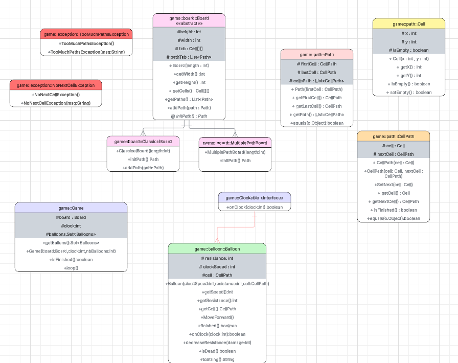

### Difficultés restant à résoudre

## Livrable 3

### Atteinte des objectifs

Au cours de ces deux dernières semaines, nous avons principalement travaillé sur l’ajout de nouvelles fonctionnalitées et sur l’amélioration de l’architecture globale du projet. Nous avons d’abord pris le temps de retravailler l’UML afin d’y intégrer de nouvelles classes importantes comme Tower, Bullet et une classe abstraite Effect ainsi que ses sous classes propre à chaque effet. Et des modifications de la classe Game pour prendre en compte la gestion des effets. Cette étape de réflexion nous a permis de mieux organiser les interactions entre les différents objets du jeu.

Nous avons ensuite implémenté les fonctionnalités prévues, notamment le système d’effets (ralentissement, gel, dégâts), ainsi que les nouvelles interactions entre tours, projectiles et ballons. La structure du projet a aussi évolué avec l’introduction d’une classe abstraite commune permettant d’unifier la gestion des objets du jeu, ce qui facilite leur manipulation et leur stockage dans des collections communes.
Le travail réalisé la semaine précédente sur l’UML nous a permis d’implémenter efficacement la plupart des éléments sans trop d’obstacles majeurs. La répartition du travail entre les membres a bien fonctionné, ce qui nous a permis d’avancer de manière régulière et de mettre en commun nos contributions pour obtenir un programme cohérent et fonctionnel.

### Difficultés restantes à résoudre

Malgré ces avancées, plusieurs difficultés ont persisté pendant l’implémentation.

Tout d’abord, notre UML initial ne prenait pas en compte suffisamment de détails : certaines classes manquaient d’attributs importants, ce qui nous a obligés à adapter le modèle en cours de développement. Cela montre que notre phase de conception peut encore être améliorée pour anticiper davantage les besoins du code.

Nous avons aussi rencontré des problèmes de référencement d’objets. Il est essentiel de bien savoir sur quel objet on agit à chaque moment. Par exemple, lorsqu’un effet se termine, il faut en recréer un nouveau plutôt que de réutiliser l’ancien, sinon son compteur est déjà à zéro. Ce type de gestion du cycle de vie des objets demande beaucoup de rigueur.

Enfin, la gestion d’un grand nombre d’objets reste complexe. Il faut constamment vérifier les responsabilités de chacun, leurs interactions et les informations qu’ils doivent partager. Si l’on souhaite garder un code propre et extensible, cette complexité augmente rapidement et nécessite une architecture claire ainsi qu’une bonne organisation du projet.

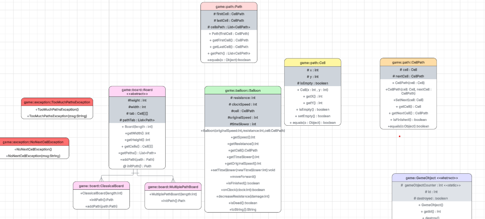
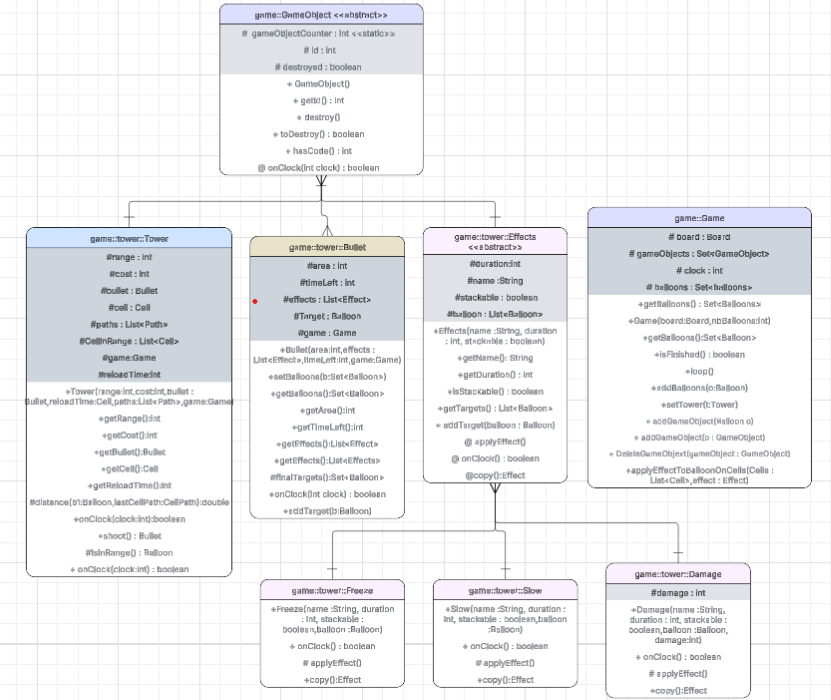

## Livrable 4
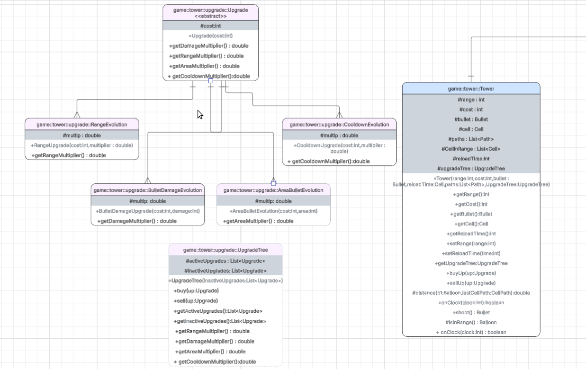
### Atteinte des objectifs
Au cours de ce livrable, nous avons implémenté un système d’upgrades permettant de faire évoluer dynamiquement les tours. Une première approche consistait à modifier directement les attributs des tours (portée, dégâts, cadence), mais celle-ci s’est révélée limitée, notamment pour gérer la revente des améliorations. Nous avons donc repensé ce système en adoptant une modélisation basée sur des multiplicateurs.

Désormais, chaque tour possède deux listes distinctes : une liste d’évolutions actives et une liste d’évolutions inactives. Lorsqu’un joueur achète une amélioration, celle-ci est déplacée dans la liste des évolutions actives ; inversement, lorsqu’elle est vendue, elle est replacée dans la liste des évolutions inactives. Ce fonctionnement permet de ne jamais perdre l’information sur les upgrades disponibles tout en facilitant les changements d’état.

Les effets des évolutions sont appliqués dynamiquement : à chaque mise à jour, la tour parcourt la liste des évolutions actives et cumule leurs multiplicateurs (portée, dégâts, vitesse d’attaque, etc.). Chaque type d’évolution n’impacte qu’une caractéristique donnée, les autres multiplicateurs restant neutres (valeur nulle ou 1 selon l’implémentation), ce qui garantit une composition correcte des effets même lorsque plusieurs upgrades sont appliquées simultanément.

Ce changement de modélisation a impliqué des modifications importantes dans les classes Tower, Bullet et Upgrade, ainsi que l’ajout de nouvelles méthodes pour gérer l’achat, la vente et l’application des effets. Enfin, nous avons également finalisé l’implémentation du système de vagues dans la classe Game, permettant de structurer le déroulement du jeu en plusieurs phases successives.

### Difficultés restant à résoudre
La principale difficulté a été de repenser entièrement le système d’upgrades afin de gérer correctement la revente. L’ancienne implémentation, basée sur des modifications directes des attributs, ne permettait pas de revenir facilement à un état précédent sans stocker des copies des objets. Le passage à un système basé sur des listes d’évolutions et des multiplicateurs a permis de résoudre ce problème, mais a nécessité une refonte importante du code.
Maintenant dans le prochain livrable nous allons ajouter un moyen de gérer les evolutions en les achetant ou les vendant a chaque manche avec un systeme de monnaie, recuperer notre argent apres la vente d'une evolution etc.
*Commandes pour compiler et executer les fichiers :*
```bash
    make classes

```
```bash
    make tests
    
```
```bash
    make jar
    
```
```bash
    make runtests
    
```
```bash
    make docs
    
```
```bash
    make docs
    
```
*Pour executer les jar :*
```bash
    make execjar4aEx
    make execjar4bEx  
```
```bash
    make clean
    
```
## Livrable 5
*Commandes pour compiler et executer les fichiers :*
```bash
    make all

```
```bash
    make clean

```

*Exemple *
```bash
    make execjar5

```

### Atteinte des objectifs
Au cours de ce livrable, nous avons mis en place la gestion de l'économie du joueur et restructuré les interactions avec le jeu. Une première approche aurait consisté à appeler directement les méthodes de construction depuis notre programme principal, mais cela créait une dépendance trop forte avec l'affichage. Nous avons donc créé une interface ManageAction implémentée par des classes spécifiques (BuyTowerAction, UpgradeTowerAction, SellTowerUpgradeAction).

Maintenant, le Shop fonctionne comme un catalogue contenant uniquement des "modèles" de tours. Lorsqu'un joueur effectue un achat via une Action, le système vérifie son solde d'or, lui retire de l'argent, clone le modèle de la boutique et place la nouvelle tour sur le plateau. Ce fonctionnement permet de sécuriser les transactions du joueur.

### Difficultés restant à résoudre
La principale difficulté de ce livrable a été de synchroniser correctement la boucle des manches, avec les événements du jeu et les conditions de victoire.

 De plus un défi d'équilibrage subsistait concernant l'apparition des ballons.La différence entre la vitesse d'attaque de nos tours et la vitesse de déplacement des ballons crée un effet de blocage où de nombreux ballons sont détruits avant même d'avoir pu avancer. Dans la version finale du projet, il nous faudra donc équilibrer les statistiques globales des tours et intégrer l'InteractiveListChooser pour les choix d'un vrai joueur.

 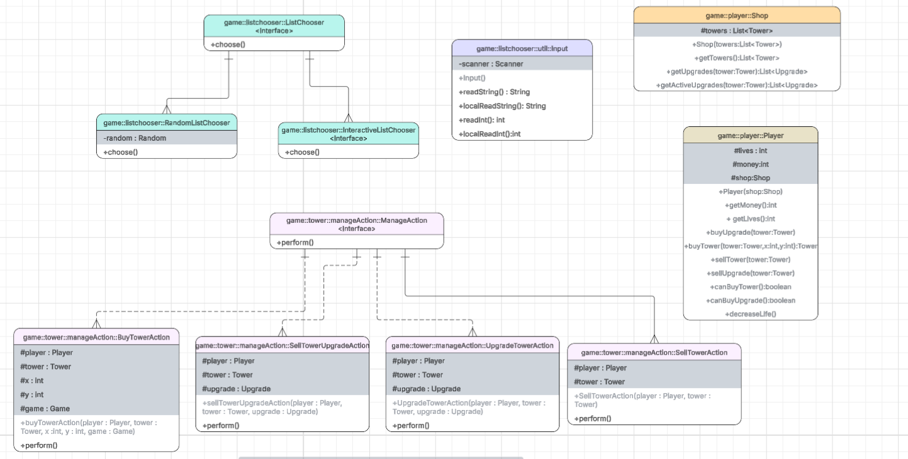
## Livrable 6

### Atteinte des objectifs

### Difficultés restant à résoudre

# Journal de bord

Le journal de bord doit être rempli à la fin de chaque séance encadrée, et **avant** de quitter la salle.

Pour chaque semaine on y trouvera :

- ce qui a été réalisé, les difficultés rencontrées et comment elles ont été surmontées (on attend du contenu, pas uniquement une phrase du type "tous les objectifs ont été atteints")
- la liste des objectifs à réaliser d'ici à la prochaine séance encadrée

## Semaine 1

### Ce qui a été réalisé
Pour commencer, on a essayé de mieux comprendre le jeu en y jouant, puis on a commencé le diagramme UML, on s'est concentré sur le plateau et la gestion des cellules et chemins.
### Difficultés rencontrées
savoir comment modéliser un chemin, et savoir quel méthode mettre dans le plateau notamment pour savoir comment accéder à la cell suivante. C'est pourquoi nous avons décidé d'y remédier avec classe "CellPath".
### Objectifs pour la semaine et répartition du travail par membre
Finir le diagramme pour les plateaux différents. Pour cette semaine, aucune répartion car nous allons le faire en groupe pour aligner nos idées, nous allons notamment écrire les sous-classes de board.


## Semaine 2

### Ce qui a été réalisé
Pour commencer nous avons modifier l'UML afin d'obtenir notre version potentiellement finale de la partie Board(les chemins,les cellules et le board en lui même ainsi que ces exceptions). Nous avons notamment terminer les sous classes de Board, 2 sous classes différente en fonction du type de plateau. Ensuite nous avons commencer a coder en se repartissant les classes.


### Difficultés rencontrées
La création des chemins notamment la méthode initPath de la classe classicalBoard (nous n'avons pas encore commencé MultipleBoard), pour l'instant on a une idée de comment faire que l'on essayera de finir dans la semaine.

### Objectifs pour la semaine et répartition du travail par membre
Chacun finis ses classes, documentation et tests compris :
Merwan : TooMuchPathsException, NoNextCellException, CellPath
Yanis : Board <<abstract>>
Jean-Mayes : Cell, Path
Noé : ClassicalBoard 
Pour ce qui est de MultipleBoard on essayera de refléchir ensemble en essayant de reprendre un petit peu le code de ClassicalBoard 

## Semaine 3


ne pas prendre en compte la classe balloon !!

### Ce qui a été réalisé : 
On a essayé de mettre en commun le projet chacun a merge sa partie, on a modifié les erreurs et les incohérences ce qui a entrainé des modifications de l'UML et des tests. Un affichage a été rajouté dans la classe classicalBoard. La classe MultipleBoard est finis mais pas encore testé.

### Difficultés rencontrées
La majorité des difficultés rencontrés aujourd'hui etait dans la manipulation de gitlab et notamment des merges qui nous ont pris beaucoup de temps a regler (... commit behind). 

### Objectifs pour la semaine et répartition du travail par membre
Tout tester et tout compiler pour le livrable de cette semaine.

UPDATE de fin de semaine :

Nous avons rencontré d'autres problemes sur la compilation commune car chacun avait encore des petites erreurs mais nous avons enfin pu finir et faire les deux main (pas tres complexe mais necessitant un code qui compile parfaitement dans tout le projet).

## Semaine 4

### Ce qui a été réalisé


Nous avons d'abord pris une heure de notre temps pour réaliser l'UML sur tout ce qui concernait le livrable 2.
Nous avons par la suite codé toutes les classes et interfaces ci-dessus avec cette répartition.

Merwan : tests de balloon et livrable 2a (ClassicalBoard)
jean-Mayes : tests de Game et livrable 2b (MultiplePathBoard)
Noé : classe Game et interface Clockable
Yanis : classe Balloon

### Difficultés rencontrées
La difficulté majeure réside toujours dans la coordination, il faut être sûr que tout le monde se comprenne bien. Mais après 4 semaines de collaboration, nous apprenons petit à petit à travailler ensemble.

En terme de difficultés techniques. Cette semaine ne nous a pas réellement posé de soucis. La seule difficulté étant l'implémentation de la clock pour les ballons qui devraient par la suite être la même que les tourelles. Celle-ci à pu être géré grâce à une interface.

### Objectifs pour la semaine et répartition du travail par membre
Pour la semaine, nous devons encore veiller à la bonne compilation et exécution des différents classes, interfaces, tests et documentation.

## Semaine 5

### Ce qui a été réalisé

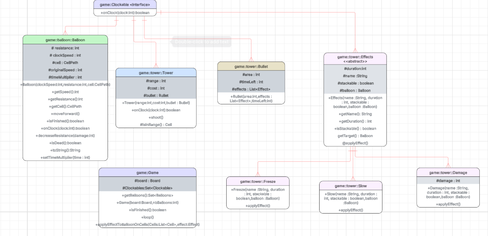
Nous avons pris le temps pour bien se mettre d'accord sur l'uml, nous avons rajouté une classe bullet, tower et  abstraite effect, et on a modifié la classe game et balloon pour prendre en compte les effets. 

### Difficultés rencontrées
La Gestion des effets (surtout le Slow) nous a posé problème. Nous avons passé beaucoup de temps a réflechir comment ralentir un objet sans le sortir de son rythme de jeu. Etant donné qu'on utilise des modulo pour déterminer le tour de chaque objet comment temporairement changer son modulo pour diminuer le nombre de tour que peut jouer un objet dans une durée donnée. Et comment ensuite après un certain nombre de tours comment lui redonner sa vitesse originelle.
### Objectifs pour la semaine et répartition du travail par membre
Merwan : Effects,damage, Slow et Freeze .
Yanis : modifications de balloon et tests
J-M : Tower et bullet et les tests
Noé : modifications de game et recherche d'un systeme de Hachage pour crééer un ensemble contenant tout nos objets (ballons, tower, etc)

## Semaine 6

### Ce qui a été réalisé
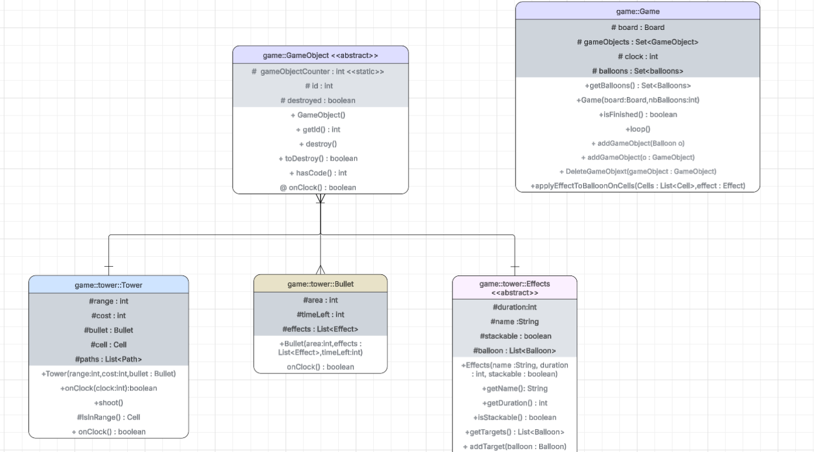
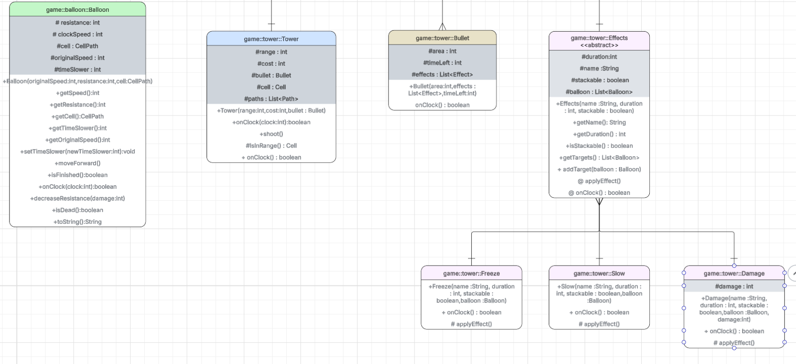

Nous avons implémentés toutes les fonctionnalités auxquelles nous avons réfléchis la semaine dernière. Nous avons aussi aussi changé la structure générale du projet en remplaçant l'interface Clockable par une classe abstraite gameObject qui gère tous les objets du jeu (Tower, Balloon, Effect ...).


### Difficultés rencontrées
Etant donné le temps passé la semaine dernière sur l'UML et le travail de réflexion collectif, nous n'avons rencontrés aucune difficulté à coder la plupart de ce qui était prévu, cependant nous avons tout de même rencontrés quelques difficultés.

Sur la méthode range de la classe tower, nous n'avions pas réfléchi à la manière d'accéder aux cellules voisines dans la portée, donc il a fallu trouver une solution.

En ce qui concerne la partie sur la nouvelle classe abstraite, il a fallu se documenter pour savoir comment rendre efficacement un objet hashable.

### Objectifs pour la semaine et répartition du travail par membre

Finaliser les tests pour toute l'équipe, tout mettre en commun, tester, puis faire les mains et le livrable.

## Semaine 7

### Ce qui a été réalisé
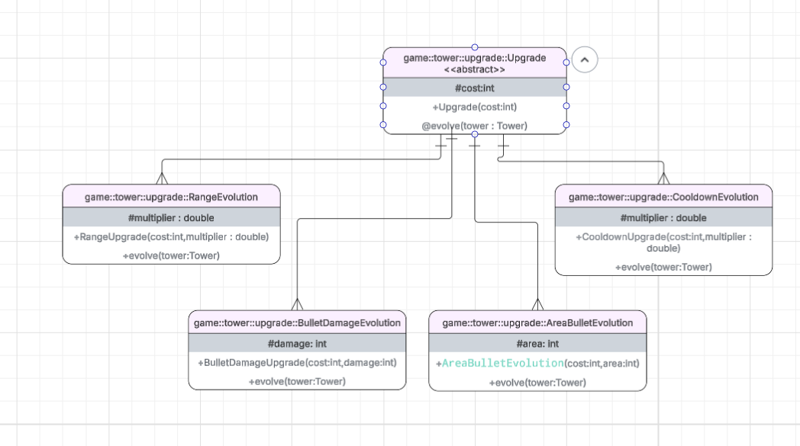
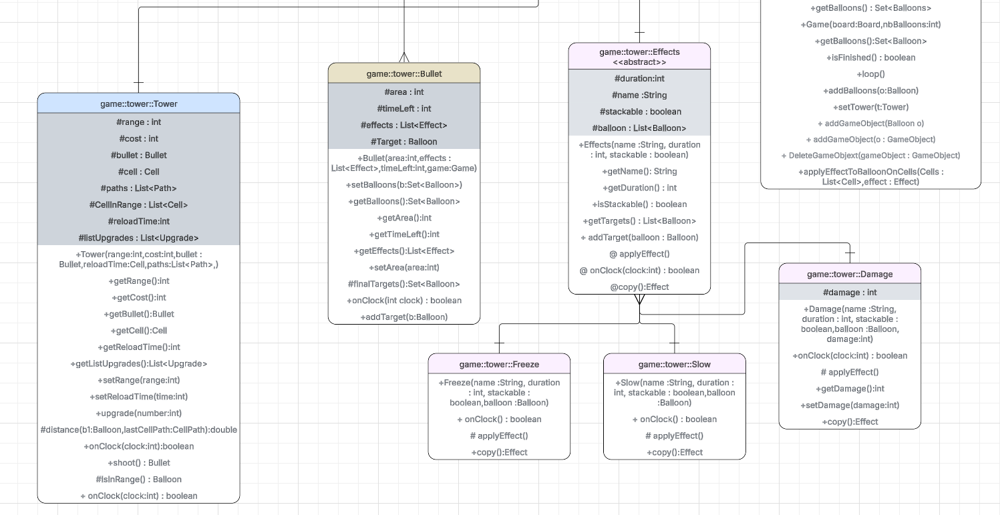

Nous sommes en train d'implémenter des fonctionnalités upgrades qui permettront de modifier les tours afin d'appliquer les évolutions.
Nous avons aussi du rajouter un attribut dans la classe tour afin de rajouter une liste d'évolutions possibles qui sera pris dans la construction.

### Difficultés rencontrées
La seule difficulté rencontrée cette semaine est qu'il faut bien faire attention à pouvoir appliquer plusieurs évolutions sans effacer celles qui ont étés appliquées précedemment.

### Objectifs pour la semaine et répartition du travail par membre
Merwan : classe CooldownEvolution, AreaBulletEvolution et modification de la classe Damage.
Yanis : classe RangeEvolution et BulletDamageEvolution.
J-M : modification de la classe Tower.
Noé : modification de Bullet et ajout de la classe abstraite Upgrade.

## Semaine 8

### Ce qui a été réalisé

### Difficultés rencontrées

### Objectifs pour la semaine et répartition du travail par membre

## Semaine 9

### Ce qui a été réalisé

Grosses modifications au niveau des upgrades avec un changement du systeme, nous partons sur un systeme de multiplier pour gérer l'évolution de nos tours. Des modifications doivent donc être apporté a la classe Tower, une methode pour acheter et une methode pour vendre les evolutions ainsi qu'une methode pour appliquer le multiplier.
Des modifications ont donc aussi été ajouté au code de la semaine precedente sur la partie Upgrade avec de nouvelles methodes pour obtenir les multipliers de chaque evolution.
Ces multiplier seront ensuite additionnés pour permettre d'appliquer plusieurs evolutions a la meme tour.
Enfin en vu d'ajouter un systeme de manche dans le livrable nous reflechissons a modifier la classe Game.
### Difficultés rencontrées
La semaine precedente nous avions totalement oublié de prendre en compte le fait que nous pouvons acheter mais surtout REVENDRE une evolution. Notre precedente implementation qui modifiait directement la valeur des degats etc n'etait donc pas optimale car si l'on voulait vendre une evolution et revenir a un etat precedent il aurait fallu sauvegarder une copie de la tour comme elle etait avant l'evolution. Avec nôtre nouveau systeme les evolutions actives sont stockées dans une liste, les inactives aussi et il suffit juste de switcher une evolution d'une liste a une autre.
Ensuite lors d'une upgrade on itere sur la liste des evolutions actives et on recupere admettons leur multiplier de range, on additionne tout. L'evolution qui s'occupe de range va ajouter une valeur les autres additionnerons 0 donc a la fin nous aurons bien le bon multiplier.


### Objectifs pour la semaine et répartition du travail par membre
Yanis - modifications de classe Upgrade et ajoute de la classe UpgradeTree
JM - modifications de Tower
Merwan - Livrable4a et readme livrable
noe - Livrable 4b et ajout de la methode playWave 
## Semaine 10

### Ce qui a été réalisé
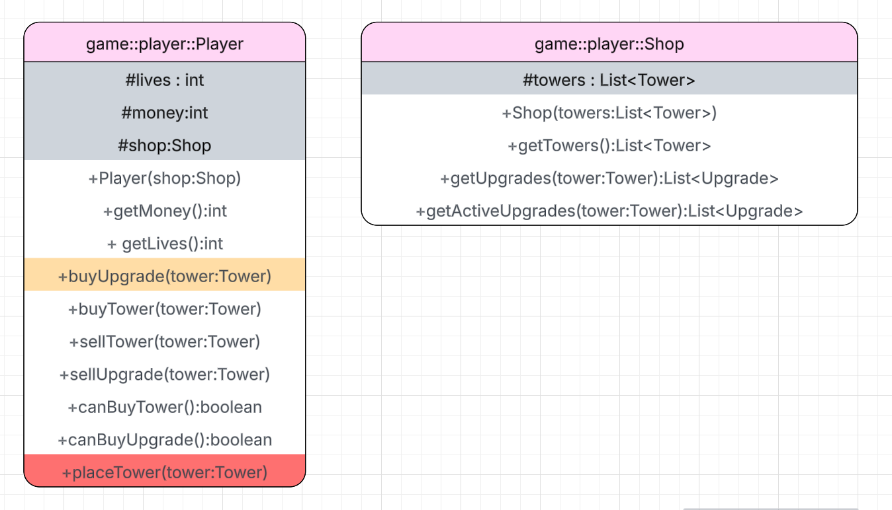
Nous avons décidé d'ajouter une classe Player afin de gérer le joueur, son argent, ses actions ainsi qu'une classe shop qui determinera ce qu'il pourra acheter.
Nous n'avons pour l'instant pas ajouter de classe pour utiliser Scanner car nous voulons d'abord revoir son utilisation.
### Difficultés rencontrées
Nous n'avons pas été clair sur l'effet exact des méthodes buyTower, buyUpgrade etc ... de la classe Player. Donc nous avons pour l'instant une v1 qui s'occupe uniquement de la partie transaction. Nous prévoyons sûrement d'ajouter d'autres effets à ces méthodes afin de pouvoir par exemple poser une tour grâce à ses méthodes.

### Objectifs pour la semaine et répartition du travail par membre
Yanis - Livrable et utilisation de Scanner
JM - Livrable et ajout de tests
Merwan - classe Player
noe - classe Shop et modification de la classe Game

## Semaine 11

### Ce qui a été réalisé
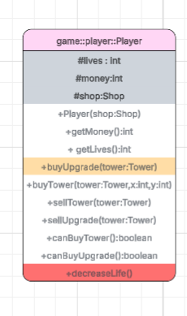
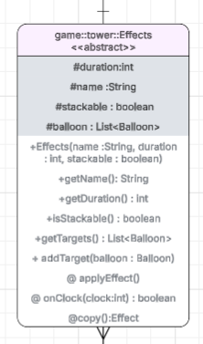
Nous avons réalisé une nouvelle version de Player qui cette fois ci prend en compte le placement et la suppression des tours et des evolutions dans le jeu.
Nous avons aussi débuté le travail sur les livrables.

### Difficultés rencontrées
Se souvenir de quelles méthodes appeler pour la gestions des tours et des evolutions et savoir où l'on traite ces méthodes (Ex : doit on placer une tour depuis la classe Game ou la classe Player).
Comprendre le fonctionnement de listchooser pour pouvoir l'implementer efficacement dans notre jeu. Elle nous sera notamment utile dans le placement des tours.

### Objectifs pour la semaine et répartition du travail par membre
Yanis - Livrable5a et implementation de listchooser
JM - Livrable5b
Merwan - Finalisation de Player
noe - Implementer les inputs dans Game.

## Semaine 12

### Ce qui a été réalisé
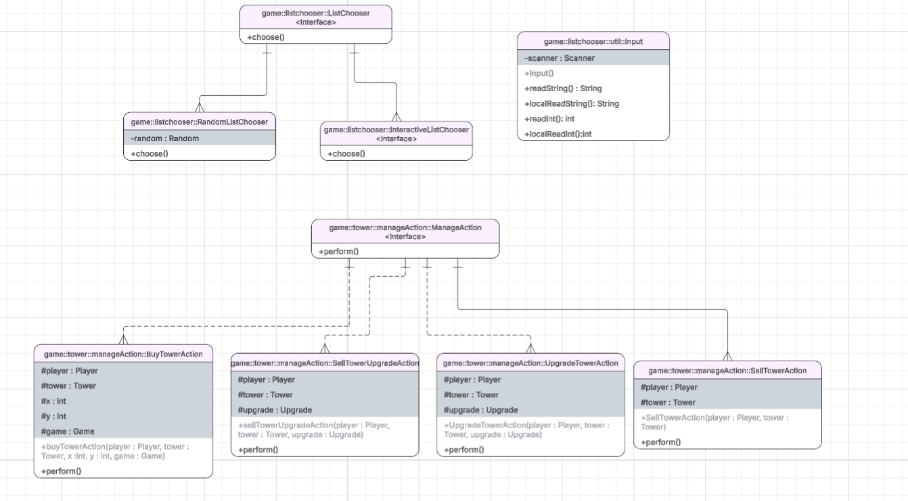
Nous avons implémentés une interface actions ainsi que toutes les classes Actions qui les implémentent afin de gérer tout type d'action effectuable par le joueur.
Nous avons aussi utilisés les listchooser pour les interactions avec le joueur

### Difficultés rencontrées*
Il s'avère que vendre et retirer les tours du jeu est assez complexe car il faut s'assurer que ce que l'on retire soit le bon objet.

### Objectifs pour finaliser le projet et répartition du travail par membre
Nous nous réunirons plusieurs fois pour discuter du projet et nous répartir les tâches au cours des 2 prochaines semaines car elles n'ont pas encore été bien répartis.